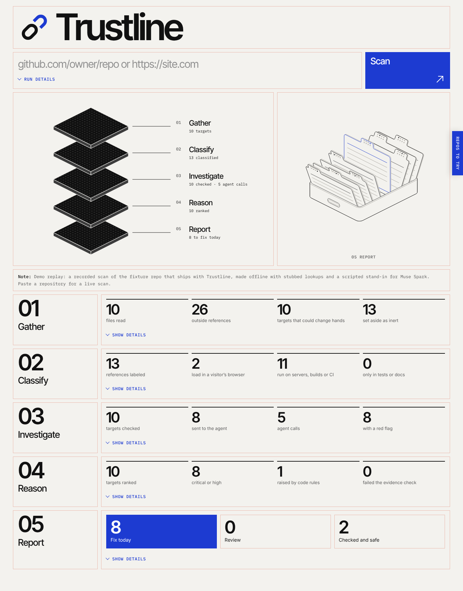

# Trustline

Code name: trustmap.

Paste a GitHub repository or a website. Trustline finds every outside domain, script,
cloud bucket, GitHub account and Action that the code trusts, checks who owns each one
now, and ranks the ones a stranger could take over: expired domains, deleted buckets,
abandoned accounts, unclaimed hosting. Detection only: it never registers or claims
anything.



The page shows the scan as five layers, each filled in live from the scan's event stream:

| Layer | Engine | Code |
|---|---|---|
| 01 Gather | code: file walk or page fetch, patterns, filters | `scanner/extract.py`, `scanner/website.py` |
| 02 Classify | Muse Spark: what each reference is, where it runs, blast radius 0–3 | `scanner/classify.py` |
| 03 Investigate | code lookups (DNS, RDAP, bucket probes, GitHub, platform fingerprints, Tranco), then a Muse Spark agent that picks extra checks (crt.sh, Wayback, live fetch) | `scanner/agent.py`, `scanner/tools/` |
| 04 Reason | Muse Spark writes the risk; code checks every claim against the evidence and applies severity floors | `scanner/report.py` |
| 05 Report | code: fix today, review, checked and safe | `api/static/app.js` |

Facts come from deterministic tools and are cached in SQLite. The model never looks
anything up and never does date math.

**Repos to try** (the tab on the right edge of the page) lists real repos to scan:
popular projects nobody maintains anymore that have something to flag, polyfill.io
holdouts, quick runs and clean controls. It reads `api/static/targets.json`, so edit
that file to change the list.

This repo merges two team builds: the scanner engine from
[Git083104/trustline](https://github.com/Git083104/trustline) and the five-layer
interface from [jwang2007/trustline](https://github.com/jwang2007/trustline).

## Run locally

Python 3.11 or newer. With plain pip:

```bash
python3 -m pip install -r requirements.txt
python3 -m uvicorn api.main:app --factory --port 8000
```

Or with [uv](https://docs.astral.sh/uv/):

```bash
uv sync --group dev
uv run uvicorn api.main:app --factory --host 127.0.0.1 --port 8000
```

Open http://127.0.0.1:8000/. **Watch the demo scan** replays a recorded scan and needs no
key. Live scans need `MODEL_API_KEY` in a `.env` file next to this README or in the
environment:

```
MODEL_API_KEY=your-meta-model-api-key
```

Optional: `GITHUB_TOKEN` raises GitHub's rate limit for account and repo checks. Keep
`TRUSTMAP_ALLOW_LOCAL_SCAN` unset or `0` on any public server.

Repositories are shallow-cloned with `git`. Without a working `git` (for example a Mac
without developer tools) the scanner downloads GitHub's archive of the default branch
instead.

## Tests

```bash
python3 -m pip install pytest pytest-asyncio
python3 -m pytest -q -m 'not slow'
```

The tests use a scripted model client and stubbed lookups, so they make no network or
model calls. `-m slow` runs the live-network lookup tests.

## The demo recording

`api/demo_scan.json` is a scan of `tests/fixtures/demo_repo`, recorded through the real
API with stubbed lookups and a scripted stand-in for Muse Spark; the page says so while
it plays. To re-record it:

```bash
python3 scripts/record_demo.py          # offline, free
python3 scripts/record_demo.py --live   # real lookups and Muse Spark; needs MODEL_API_KEY
```

A `--live` recording is labelled as a live scan on the page.

## Deploy

A scan runs as a background task in the process that accepted it, streams Server-Sent
Events while it works, and caches lookups in SQLite. It runs best on a host that keeps a
process alive (Render, Fly, Railway, a VM), and it also runs on Vercel with the
trade-offs below.

### Vercel

`pyproject.toml` points Vercel at `index.py` (`[tool.vercel] entrypoint = "index:app"`),
and Vercel picks the FastAPI preset from the dependencies.

1. Push this repository to GitHub.
2. In Vercel: **Add New → Project**, import the repository, keep the detected settings.
3. Under **Environment Variables** add `MODEL_API_KEY` (and `GITHUB_TOKEN` if you have
   one), then **Deploy**.

What changes on Vercel, all handled in code when the `VERCEL` variable is present:

- The page starts and follows a scan in one request (`POST /api/scan/stream`), because
  the next request can reach a different instance. Share links are turned off there.
- A request may run for five minutes on the free plan. The agent stage stops starting
  new work 170 seconds into a scan (`TRUSTMAP_AGENT_DEADLINE_S` changes it), so ranking
  can finish; skipped targets keep their lookup facts and the code severity rules.
- Only `/tmp` is writable, so the cache lives in `/tmp/trustmap.db` and starts empty on
  each new instance. The daily spend cap and per-IP limit live there too, so they count
  per instance; the per-scan cost cap still applies to every scan.

### Render (the checked-in blueprint)

`render.yaml` describes the whole service: Docker runtime, free plan, and a health check
on `/api/health`.

1. Push this repository to GitHub.
2. In Render: **New → Blueprint**, pick the repository, apply `render.yaml`.
3. Set the two secrets it leaves blank: `MODEL_API_KEY` and `GITHUB_TOKEN`.

Everything else (the spend and rate caps, `TRUSTMAP_TRUSTED_PROXY_HOPS=1`, the cache
path) is already in the blueprint. Check the build locally first with:

```bash
docker build -t trustline . && docker run --rm -p 8000:8000 trustline
```

### What does not survive a restart

Jobs live in process memory. `GET /api/scan/{id}` and the `?scan=<id>` share link work
until the process restarts; after that the id is gone (404) and the scan has to be run
again. The demo is a checked-in recording and always works.

On the free plan there are two more consequences, because a free web service cannot
mount a disk and sleeps after 15 minutes without traffic:

- The SQLite cache at `TRUSTMAP_CACHE_DB` holds both network lookups and model
  responses, so losing it means a repeat scan of the same target pays full price
  again rather than being nearly free.
- A sleeping service takes about a minute to answer the first request. Open the site a
  minute before you demo it.

For a cache that survives, set `plan: starter` in `render.yaml` and add a disk back:

```yaml
    disk:
      name: trustline-data
      mountPath: /var/data
      sizeGB: 1
```

## API

See [docs/api.md](docs/api.md) for the scan API and every event the page listens to.
